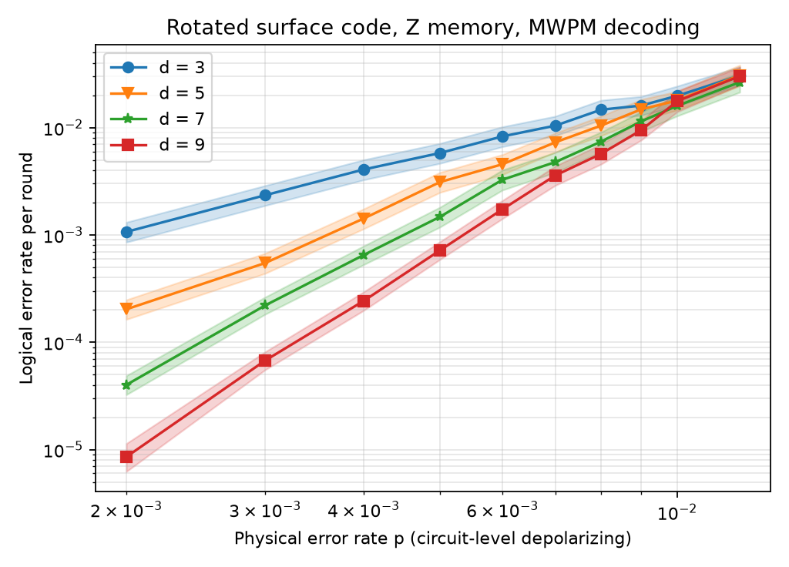

# Surface codes and qLDPC codes under circuit-level noise

Simulations of quantum error correction with [Stim](https://github.com/quantumlib/Stim):
the rotated surface code under circuit-level noise, decoded with minimum-weight
perfect matching, and (in progress) IBM-style bivariate-bicycle qLDPC codes
built from their group-algebra description and decoded with BP-OSD.

| Part | Status |
|---|---|
| 1. Surface-code threshold, circuit-level noise, MWPM (PyMatching) | ✅ |
| 2. Bivariate-bicycle codes from F2[x,y]/(xˡ−1, yᵐ−1), BP-OSD, comparison with the surface code | ⬜ in progress |
| 3. Resource estimate from the measured scaling | ⬜ |

## Part 1 result



Rotated surface code, Z-basis memory, d rounds of syndrome extraction, uniform
circuit-level depolarizing noise of strength p (two-qubit depolarizing after
every CNOT, data depolarizing each round, measurement and reset flips).
Decoded with PyMatching through `sinter`; error bars are sinter's likelihood
intervals. Raw counts: [`results/threshold.csv`](results/threshold.csv).

- **Threshold.** The curves for d = 7 and d = 9 cross between p = 0.9% and
  p = 1.0%; below that, larger codes win.
- **Error suppression.** At p = 0.2%, each step d → d + 2 lowers the logical
  error rate per round by a factor of about 5 (Λ ≈ 5.3, 5.2, 4.6 for
  3→5, 5→7, 7→9), reaching 8.5 × 10⁻⁶ per round at d = 9.
- **Cost.** Sampling plus decoding takes about 11 µs per shot at d = 9,
  p = 0.2% on a 2-core machine, rising to about 85 µs per shot near threshold,
  where the matching problem gets denser.

## Run it

Windows PowerShell:

```powershell
.\setup.ps1                       # venv, dependencies, quick run, tests
python scripts\threshold.py       # full sweep (a few minutes), rewrites results/
```

macOS/Linux:

```bash
python3 -m venv .venv && source .venv/bin/activate
pip install -r requirements.txt && pip install -e .
python scripts/threshold.py --quick --out results/quick && pytest
```

## Layout

```
src/qec_stim/
  surface.py     rotated surface-code memory circuits with circuit-level noise
  decode.py      detector error model → PyMatching → logical error rate
  bb_code.py     bivariate-bicycle check matrices over F2          (Part 2)
  resource.py    scaling fit and qubit-count estimate               (Part 3)
scripts/threshold.py   the Part 1 sweep, CSV and plot
tests/                 pytest; Parts 2–3 skip until implemented
docs/walkthrough.md    how the pipeline works, step by step
```

## How this was built

The Part 1 pipeline and the test harness were written with AI assistance and
reviewed by me. The code construction, decoder comparison and resource estimate
(Parts 2–3) are my own work. The split is recorded in [CLAUDE.md](CLAUDE.md).

## References

- C. Gidney, "Stim: a fast stabilizer circuit simulator", Quantum 5, 497 (2021).
- O. Higgott, C. Gidney, "Sparse Blossom: correcting a million errors per core second with minimum-weight matching" (PyMatching v2), 2023.
- S. Bravyi et al., "High-threshold and low-overhead fault-tolerant quantum memory", Nature 627, 778 (2024).
- J. Roffe et al., "Decoding across the quantum low-density parity-check code landscape" (BP-OSD, `ldpc`), 2020.
